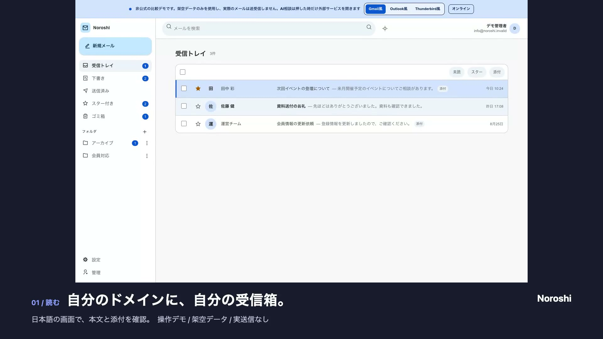

# Noroshi

[](LICENSE.md)

> ### **[ライブデモを試す](https://noroshi-ui-preview.pages.dev/)** 👈

## 自分のドメインで、読む。返す。整理する。

独自ドメインのメールを、自分のCloudflareアカウントで送受信する、日本語のセルフホスト型Webメールです。
メールサーバーを借りない、運用しない。導入はAIが案内し、人はログイン、秘密値の入力、管理画面での確認と承認を行います。

### ▶️ [動画で見る（36秒）](https://noroshi-ui-preview.pages.dev/guide/)

[](https://noroshi-ui-preview.pages.dev/guide/)

[製品ガイド](https://noroshi-ui-preview.pages.dev/guide/) / [ライブデモ](https://noroshi-ui-preview.pages.dev/) / [動画を開く（MP4）](https://noroshi-ui-preview.pages.dev/guide/noroshi-product-tour.mp4)

動画とデモは架空のメールを使った操作例です。

**構成**: TypeScript / SvelteKit / Cloudflare Workers + D1 + R2 / Resend / MIT License

---

## できること

| | 内容 |
| --- | --- |
| 読む | 受信トレイ、スレッド表示、スター、添付のダウンロード、ライトとダークのテーマ、デスクトップ通知、スマホ対応（PWA） |
| 返す | 返信、新規作成、下書き、署名と差出人名、添付（1件5MiB、合計25MiB、最大5件） |
| 整理する | フォルダー作成、差出人と件名による自動振り分け |
| 転送する | 1通ずつの手動転送。受信後の自動転送（宛先の確認、有効と無効の切り替え、状態表示、二重送信防止） |
| 複数で使う | 複数のドメイン、ユーザー、アドレスを1つの環境で |
| 持ち込む | OutlookやEMLファイルから過去メールを取り込み |
| つなぐ | REST API、CLI `noroshi`、MCPサーバー（AIクライアントからメールボックスを操作） |
| 保存先 | 受信メール、送信履歴、添付はすべて自分のCloudflareアカウント（D1とR2） |

受信はCloudflare Email Routing、送信はResendを使います。どちらも利用者自身のアカウントです。

---

## 費用

「メールアドレスが欲しいだけ」のために、1ユーザーごとの月額を払い続けていませんか。

| | Google Workspace Business Starter | Noroshi |
| --- | --- | --- |
| 課金単位 | 1ユーザーごとの月額 | 固定費なし。自分のCloudflareとResendの利用量に応じて |
| 月額 | ¥800 / ユーザー（年契約の標準価格。最初の3か月は¥400。2026-09-03時点の[公式価格](https://workspace.google.com/intl/ja/pricing)） | ¥0から |
| 計算例: 5人で1年（標準価格） | ¥48,000 | 無料枠内なら ¥0（ドメイン代は別） |
| 無料枠 | なし | Cloudflare Email Routing 無料、Workers 10万リクエスト/日、Resend 3,000通/月（100通/日）、D1とR2にも無料枠 |
| メールの保存場所 | Googleのサーバー | 自分のCloudflareアカウント |
| ソースコード | 非公開 | MIT |

Microsoft 365 Business Basicも同じく1ユーザーごとの月額課金です（[公式価格](https://www.microsoft.com/ja-jp/microsoft-365/business)）。
Noroshi自体は無料です。独自ドメインの取得と更新費、無料枠を超えた分は利用者の負担です。料金は変わるため[Cloudflare](https://www.cloudflare.com/plans/developer-platform/)と[Resend](https://resend.com/pricing)の公式ページで確認してください。

---

## 導入する

導入はAIが手順を案内し、ターミナルで実行できる作業（依存の導入、D1とR2の作成、デプロイ）は1操作ずつ確認を取りながら進めます。人が行うのは次の作業です。

1. 各サービスへのログイン（MFA、CAPTCHA、規約同意を含む）
2. 独自ドメインの取得と支払い
3. 秘密値（APIキー、セットアップキー）の入力。AIには見せません
4. CloudflareとResendの管理画面での設定操作（Email Routingの有効化、Catch-allの接続、DNSレコードの追加）。AIが画面と場所を示します
5. 最初の管理者の作成

### 用意するもの

1. 独自ドメイン（DNSをCloudflareで管理できるもの）
2. Cloudflareアカウント（無料プランで可）
3. Resendアカウント（無料プランで可）
4. ターミナルまたはブラウザを操作できるAI

### AIに渡す指示文

使っているAIに合わせて、次のどれかをそのまま貼り付けます。`example.com`は自分のドメインに置き換えてください。

#### Codex CLI

空のフォルダーで`codex`を起動し、次を送ります。

```text
Noroshi（https://github.com/Chachamaru127/noroshi）を私のCloudflareアカウントに導入してください。

1. リポジトリをこのフォルダーへcloneし、skills/quickmail-ja-setup/SKILL.md と docs/setup-and-operations.md を読んでから始めてください。
2. 必要なツール（Bunなど）は、インストール前に私へ確認してください。
3. あなたが使える機能（ターミナル、ブラウザ操作）を確認し、使えない操作は「私が開く公式画面と操作」として1つずつ示してください。
4. 私が行うこと: 各サービスへのログイン、MFA、支払い、秘密値（APIキー、セットアップキー）の入力、DNS/MX変更の最終承認、最初の管理者の作成。秘密値をチャットに貼らせないでください。
5. 変更は1操作ずつ、対象と戻し方を示してから私の確認を取ってください。
6. 完了後、受信と送信を別々にテストして結果を報告してください。

ドメイン: example.com
```

#### Claude Code

空のフォルダーで`claude`を起動し、次を送ります。

```text
Noroshi（https://github.com/Chachamaru127/noroshi）を私のCloudflareアカウントに導入してください。

1. リポジトリをこのフォルダーへcloneし、skills/quickmail-ja-setup/SKILL.md と docs/setup-and-operations.md を読んでから始めてください。
2. 必要なツール（Bunなど）は、インストール前に私へ確認してください。
3. あなたが使える機能（ターミナル、ブラウザ操作、Computer Use）を確認し、使えない操作は「私が開く公式画面と操作」として1つずつ示してください。
4. 私が行うこと: 各サービスへのログイン、MFA、支払い、秘密値（APIキー、セットアップキー）の入力、DNS/MX変更の最終承認、最初の管理者の作成。秘密値をチャットに貼らせないでください。
5. 変更は1操作ずつ、対象と戻し方を示してから私の確認を取ってください。
6. 完了後、受信と送信を別々にテストして結果を報告してください。

ドメイン: example.com
```

#### ChatGPT（Work）

ChatGPTデスクトップアプリでWork（ローカルのファイルとブラウザを扱えるモード）を開き、次を送ります。

```text
Noroshi（https://github.com/Chachamaru127/noroshi）を私のCloudflareアカウントに導入してください。

1. リポジトリを取得し、skills/quickmail-ja-setup/SKILL.md と docs/setup-and-operations.md を読んでから始めてください。
2. あなたが使える機能（ターミナル、ブラウザ操作）を確認してください。ターミナルが使えない場合は、私が実行するコマンドを1つずつ示してください。私が実行して結果を貼ります。
3. ブラウザ操作が使える場合は、CloudflareとResendの公式画面を開いて、私が操作する場所を示してください。
4. 私が行うこと: 各サービスへのログイン、MFA、支払い、秘密値（APIキー、セットアップキー）の入力、DNS/MX変更の最終承認、最初の管理者の作成。秘密値をチャットに貼らせないでください。
5. 変更は1操作ずつ、対象と戻し方を示してから私の確認を取ってください。
6. 完了後、受信と送信を別々にテストして結果を報告してください。

ドメイン: example.com
```

#### Claude（Cowork）

ClaudeデスクトップアプリでCoworkを開き、次を送ります。

```text
Noroshi（https://github.com/Chachamaru127/noroshi）を私のCloudflareアカウントに導入してください。

1. リポジトリを取得し、skills/quickmail-ja-setup/SKILL.md と docs/setup-and-operations.md を読んでから始めてください。
2. あなたが使える機能（ターミナル、ブラウザ操作、Computer Use）を確認してください。ターミナルが使えない場合は、私が実行するコマンドを1つずつ示してください。私が実行して結果を貼ります。
3. ブラウザ操作が使える場合は、CloudflareとResendの公式画面を開いて、私が操作する場所を示してください。
4. 私が行うこと: 各サービスへのログイン、MFA、支払い、秘密値（APIキー、セットアップキー）の入力、DNS/MX変更の最終承認、最初の管理者の作成。秘密値をチャットに貼らせないでください。
5. 変更は1操作ずつ、対象と戻し方を示してから私の確認を取ってください。
6. 完了後、受信と送信を別々にテストして結果を報告してください。

ドメイン: example.com
```

自分で進める場合は、[導入と運用ガイド](docs/setup-and-operations.md)の手順で`bun run setup`を実行します。

---

## しくみ

```
[ 差出人 ]
    │ MX
[ Cloudflare Email Routing ]
    │
[ Noroshi ]  SvelteKit on Cloudflare Workers
    ├─⇄ [ D1 ]  本文、索引、送信履歴
    ├─⇄ [ R2 ]  添付
    │ 送信
[ Resend ] → [ 宛先 ]
    │ 配信結果（Webhook）→ D1

[ ブラウザ / PWA ] ⇄ Web UI
[ noroshi CLI / MCP ] ⇄ REST API
```

---

## ライセンスと由来

MIT Licenseです。原文は[LICENSE.md](LICENSE.md)を参照してください。

Noroshiは[DivinPrince/quickmail](https://github.com/DivinPrince/quickmail)を上流として、日本語UIとセルフホスト運用機能を追加した派生版です。上流の著作権表示とMITライセンスを維持します。
名前は、離れた相手へ合図を届けた「狼煙」に由来します。

Issue / PRは[Chachamaru127/noroshi](https://github.com/Chachamaru127/noroshi)へ。開発者: [@Chachamaru127](https://github.com/Chachamaru127)

---

## 補足

- 動画とライブデモの「Gmail風」「Outlook風」「Thunderbird風」は比較デモ限定で、本番画面の機能ではありません。各社とは無関係の独自実装です。
- 対応していないもの: IMAP / POP、Gmailとの双方向同期、大量配信やメルマガ、Google WorkspaceやMicrosoft 365との機能互換。
- Resend無料プランは1日100通までです。それ以上はResendの有料プランが必要です。
- 導入と運用の詳細（DNS、コスト、バックアップ、復旧、更新、API / CLI / MCP、開発コマンド）: [docs/setup-and-operations.md](docs/setup-and-operations.md)
- 仕様の正本: [spec.md](spec.md)。添付APIの変更点: [docs/release-notes-1.0.md](docs/release-notes-1.0.md)
