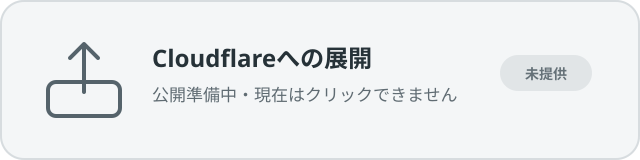

# QuickMail-ja

[](LICENSE.md)

QuickMail-jaは、独自ドメインのメールを自分のCloudflare環境で管理する、日本語固定UIのセルフホスト型Webメールです。受信メール、送信履歴、添付ファイルを自分のCloudflareアカウントに保存します。

**導入はBYOK（Bring Your Own Key / Account）です。** Cloudflare、Resend、将来提供するGmailコネクターのGoogle Cloudは、利用者自身のアカウントと認証情報を使います。QuickMail-ja共通のAPIキーやOAuth Clientは配布しません。アカウント、利用料金、保存データ、認証情報は利用者が管理します。

QuickMail-jaの公開リポジトリのURLは未設定です。そのため、リモートインストーラーやクリック可能なDeployボタンは提供していません。現在は、このソース一式を入手した環境でセットアップしてください。

## Cloudflareへの展開



**公開準備中 — 現在のバナーはクリックできません。**

Cloudflare公式の[Deploy to Cloudflareボタン](https://developers.cloudflare.com/workers/platform/deploy-buttons/)は、公開されたGitHubまたはGitLabリポジトリからWorkerを複製し、D1やR2など対応リソースの作成と紐付け、ビルド、デプロイを開始する仕組みです。QuickMail-jaの公開リポジトリURLとリリース承認が揃った後だけ有効にします。非公開リポジトリ、元の英語版、復旧用リポジトリは導入元にしません。

**デプロイ完了とメール開通は別です。** Workerの展開後も、次の作業が残ります。

1. Resendへ送信用ドメインと送信用DNSを設定
2. Cloudflare Email Routingを有効化
3. Cloudflareが指定した受信用MXだけを設定
4. `Catch-all → Send to a Worker`でQuickMail-jaを選択
5. Resend送信キー、Webhook署名、セットアップキーなどのシークレットを安全に登録
6. D1マイグレーションを適用
7. `/setup`で最初の管理者を作成し、送受信を個別に確認

### 日本語セットアップサポートの3段階

| 導線                          | できること                                                                                | 現在の状態                                                       |
| ----------------------------- | ----------------------------------------------------------------------------------------- | ---------------------------------------------------------------- |
| AIに相談（提供中）            | 質問文をChatGPT、Claude、Geminiの新規チャットへ渡し、日本語の説明を受ける                 | QuickMail-ja、Cloudflare、Resendを読む・変更する権限はありません |
| Setup Skill（ローカル提供中） | BYOKの担当範囲、公式画面、確認項目、人間へ引き渡す操作をAIへ教える再利用可能な手順書      | 案内専用。外部設定の作成・保存・変更は行いません                 |
| Setup MCP（将来・未提供）     | 許可された確認・設定だけをツールとして実行し、1操作ごとに対象、差分、戻し方を確認する予定 | 公開前の安全強化とクライアント別検証が必要です                   |

現在利用できるAI相談ドックは、**デプロイ後のResend設定と最初の管理者作成**を支援します。`skills/quickmail-ja-setup`には、Cloudflare、Resend、将来のGmail BYOK設定を公式画面に沿って案内するポータブルSkillがあります。外部設定を自動変更するSetup MCPは未提供です。

### Setup Skillを使う

正本は[`skills/quickmail-ja-setup`](./skills/quickmail-ja-setup/)の1か所です。`.agents/skills/quickmail-ja-setup`と`.claude/skills/quickmail-ja-setup`は正本を読むだけの薄いアダプターで、手順を複製しません。

- Codex CLI／IDE向けの正しいリポジトリ配置として`.agents/skills`アダプターを同梱しています。ただし、新しいクライアントプロファイルでcloneから実際に発見されるかはQMJ-15で未検証です。現時点では自動発見を保証しません。
- Claude Code向けの正しいリポジトリ配置として`.claude/skills`アダプターを同梱しています。こちらも新しいクライアントプロファイルでの発見確認はQMJ-15まで未完了です。
- ChatGPTでは、cloneだけではインストールされません。利用可能なプラン・ワークスペースで「Plugins → Skills → Create → Upload」から、下記のZIPをアップロードします。
- Claude Desktop／Webでも、cloneだけではインストールされません。「Customize → Skills → Create skill → Upload a skill」から同じZIPをアップロードします。コード実行や利用者作成Skillが組織設定で無効な場合は利用できません。

リポジトリのルートで次を実行すると、macOSの補助ファイルやクライアント別アダプターを含まないアップロード用ZIPを`out/quickmail-ja-setup.zip`へ作成できます。

```bash
bun run package:setup-skill
```

このコマンドは、現在checkoutしているコミットのSkillをパッケージ化します。未コミットの変更は入りません。ChatGPTのPersonal SkillsはデスクトップとWeb/モバイルで個別に追加する必要があります。プラン、組織設定、地域、ブラウザ操作機能によって利用可否が異なります。公式の[ChatGPT Skills案内](https://help.openai.com/en/articles/20001066)と[Claude Skills案内](https://support.claude.com/en/articles/12512180-use-skills-in-claude)を導入時に確認してください。

Skillはブラウザ操作機能そのものを追加しません。利用中のChatGPT/CodexまたはClaudeがブラウザ操作に対応し、利用者が許可した場合だけ、Cloudflare、Resend、Google Cloudの公式画面を開いて必要箇所まで案内します。ログイン、MFA、CAPTCHA、規約同意、支払い、秘密値入力、作成・保存・削除・DNS変更は利用者が行います。ブラウザ操作機能がない場合は、公式URLと手動のメニュー経路を案内します。

## AIに質問

AI相談ボタンは、サーバーやQuickMail-jaのAPIキーを使わず、画面に表示した質問文をChatGPT、Claude、Geminiへ渡す補助機能です。各ボタンを押すと質問文のクリップボードへのコピーを開始し、対応するHTTPSページを新しいタブで開きます。

- ChatGPTとClaudeは、質問文を`q`パラメータにも入れて事前入力を試みます。
- GeminiはWebページを開き、コピーした質問文を利用者が貼り付けます。
- 事前入力やクリップボードは、ブラウザの仕様、権限、ログイン状態によって利用できない場合があります。画面には質問文を選択できる形で残します。
- 端末やOSの関連付けによって、インストール済みアプリまたはブラウザで開く場合があります。QuickMail-jaは起動先を保証せず、独自URLスキームも使いません。
- 質問文は自動送信しません。利用者が内容と送信先を確認し、AIの入力欄から送信します。

AIには、回答するたびに公式ドキュメントを実際に開き、確認日と参照URLを示すよう依頼します。AIの記憶や検索結果の要約だけを設定根拠にはしません。入口として使う公式案内は、[ChatGPT Help Center](https://help.openai.com/en/articles/12677804-what-is-chatgpt-faq)、[Claude Help Center](https://support.claude.com/en/articles/8114491-get-started-with-claude)、[Gemini Apps Help](https://support.google.com/gemini/answer/13275745?hl=ja)です。各サービスの画面や利用条件は変更されるため、回答内容を確認してから作業してください。

質問文に添える、変わりにくく頻出するトラブルは次の範囲に限定します。

- デプロイ完了とメール開通は別です。Workerの配置だけでは送受信できません。
- Cloudflareのapex MXは受信用です。ResendのReturn-Path用MXは送信用サブドメインに置きます。
- Resend Receivingは有効にしません。受信はCloudflare Email Routingを使います。
- Email RoutingのCatch-allは、QuickMail-ja Workerへ接続するまで受信を保存しません。
- セットアップキーは最初の管理者作成に使う一回限りの秘密値です。

質問文はブラウザ履歴や利用中のAIサービスに保存される場合があります。**APIキー、パスワード、メール本文、DNS値、アカウントID、個人情報は入力しないでください。** ChatGPT、Claude、Gemini、Cloudflare、ResendとQuickMail-jaは提携・公式サポート関係にありません。各サービスの回答、保存、利用条件はそれぞれの提供元に従います。

## 構成

標準構成は受信と送信を分けます。

| 役割       | 使用サービス                                 | 保存先                   |
| ---------- | -------------------------------------------- | ------------------------ |
| 受信       | Cloudflare Email Routing → Workerの`email()` | 本文・索引はD1、添付はR2 |
| 送信       | Resend API                                   | 送信履歴はD1、添付はR2   |
| 配信結果   | Resend Webhook                               | D1                       |
| Web UI/API | Cloudflare Workers                           | セッション・APIキーはD1  |

`INBOUND_EMAIL_PROVIDER=cloudflare`、`EMAIL_PROVIDER=resend`が標準です。受信には、対象ドメインのDNSゾーンをCloudflareで管理する必要があります。Resendは送信だけに使い、Resend Receivingは有効にしません。

初回リリースの送信はResendのみをサポートします。Cloudflare Email Routingは受信専用です。

## 主な機能

- 送受信、返信、スレッド、下書き、添付、配信状態
- 複数ドメイン・複数ユーザー・複数アドレス
- 署名と差出人名
- 1通ずつの手動転送
- 保存後の自動転送。有効・無効、宛先確認、状態表示、二重送信防止
- フォルダー、差出人・件名による自動振り分け
- 管理画面からのEML取り込み
- REST API、CLI、MCPサーバー
- ライト・ダークテーマ、デスクトップ通知

## セットアップ

### 必要なもの

1. DNSをCloudflareで管理できる独自ドメイン
2. Cloudflareアカウント
3. Resendアカウント
4. [Bun](https://bun.sh) 1.3.14（検証済みの固定バージョン）

最短手順は次のとおりです。

```bash
bun install --frozen-lockfile
bun run setup
```

Bunを導入済みなら、次の補助スクリプトでバージョンを確認して開始できます。

```bash
bash scripts/setup.sh
```

`scripts/setup.sh`はBunをダウンロードしません。Bunがない、または1.3.14以外の場合は停止します。[Bun公式手順](https://bun.sh/docs/installation)で利用者が導入し、再実行してください。依存関係は`bun install --frozen-lockfile`で固定します。

ウィザードは次を行います。

1. Cloudflareへログイン
2. メールドメインを指定。受信はCloudflare Email Routing、送信はResendに固定
3. D1 `quickmail-ja`とR2 `quickmail-ja-attachments`を作成
4. `wrangler.jsonc`とローカル用`.dev.vars`の非秘密設定だけを更新
5. 利用者がパスワード管理ツールで作成したセットアップキーを非表示入力
6. `BOOTSTRAP_SECRET`と自動生成した`AUTH_RATE_LIMIT_SECRET`をCloudflareのWorkerシークレットへ直接保存
7. Cloudflare Email RoutingとResend送信を設定
8. D1マイグレーションを適用し、確認後にデプロイ

セットアップキーは最初の管理者を作るときに使います。利用者がパスワード管理ツールで作成・保管し、ウィザードの非表示プロンプトへ入力してください。ウィザードは値を表示せず、ファイルにも保存しません。`/setup`で管理者を作成した後は破棄してください。`AUTH_RATE_LIMIT_SECRET`は認証の試行回数を安全に識別するための秘密値で、ウィザードが生成してWorkerシークレットへ直接保存します。

外部変更をまとめて承認する`--yes`はありません。アカウント、作成、シークレット登録、デプロイはそれぞれ内容を表示して確認します。QMJ-9では公開先を`workers.dev`だけに限定し、カスタムドメイン接続はQMJ-10へ延期しています。

### 手動でCloudflareリソースを作る場合

```bash
bun install --frozen-lockfile
bunx wrangler login
bunx wrangler d1 create quickmail-ja
bunx wrangler r2 bucket create quickmail-ja-attachments
```

D1作成時に表示された`database_id`を`wrangler.jsonc`の`REPLACE_WITH_YOUR_D1_DATABASE_ID`と置き換えます。デプロイ前に、同じファイルの`vars`を次のように設定します。`CLOUDFLARE_MAIL_DOMAINS`が空だと、Workerは受信ドメインを許可しません。

```json
"vars": {
  "EMAIL_PROVIDER": "resend",
  "INBOUND_EMAIL_PROVIDER": "cloudflare",
  "CLOUDFLARE_MAIL_DOMAINS": "example.com"
}
```

続いてCloudflareのネイティブな非表示プロンプトからシークレットを入力します。値をチャット、コマンド引数、ファイル、ログへ書かないでください。Workerへ渡すResendキーは対象ドメインに限定した送信専用キーです。ドメイン確認やWebhook作成に使った一時的なフルアクセスキーはWorkerへ配備せず、設定後に失効させます。

```bash
bunx wrangler secret put BOOTSTRAP_SECRET
bunx wrangler secret put AUTH_RATE_LIMIT_SECRET
bunx wrangler secret put RESEND_API_KEY
bunx wrangler secret put RESEND_WEBHOOK_SECRET
bun run db:migrate:remote
bun run deploy
```

デプロイ後、Cloudflare Email Routingで対象ドメインを有効化します。受信用MXを設定し、`Catch-all → Send to a Worker`でデプロイしたQuickMail-ja Workerを選びます。Catch-allをWorkerへ接続するまで受信メールはQuickMail-jaに入りません。

ローカル開発では次の手順を使います。

```bash
cp .dev.vars.example .dev.vars
bun run db:migrate:local
bun run setup -- --local-dev
```

`.dev.vars`には非秘密設定だけを置きます。ローカル用セットアップキーは、パスワード管理ツール等から現在のプロセスの`QUICKMAIL_BOOTSTRAP_SECRET`へ一時的に渡してください。`--local-dev`は秘密値を子の開発サーバープロセスだけへ渡し、表示も保存もしません。

受信の動作確認には`bun run preview`またはデプロイ済みWorkerを使います。Viteの開発サーバーだけではCloudflare Email Routingからメールを受信できません。

## DNS と MX

### 受信: Cloudflare Email Routing

対象ドメインの権威DNSをCloudflareへ置き、CloudflareダッシュボードのEmail Routingでドメインを有効にします。

1. Cloudflareが表示した受信用MXレコードをapexへ設定
2. Catch-allを有効化
3. `Catch-all → Send to a Worker`でQuickMail-jaのWorkerを選択
4. 外部アドレスから受信テスト

apexの受信用MXはCloudflareが表示した値だけにします。以前のメールサービスのMXを混在させると、配信先は保証されません。切り替え前に既存DNSを保存してください。

### 送信: Resend

Resendへドメインを追加し、Resendが表示した送信用DKIM、SPF、Return-Pathのレコードだけを設定します。Return-Path用MXは送信用サブドメインに置かれるため、Cloudflareのapex MXとは役割が異なります。

- Resend Receivingを有効にしない
- Resendの受信用MXをapexへ追加しない
- SPF TXTを複数作らない。既存SPFがある場合は仕様に沿って統合する
- デプロイ後、`/api/webhooks/resend`へResend Webhookを設定する

Webhookの対象イベントは`email.sent`、`email.delivered`、`email.bounced`、`email.complained`、`email.delivery_delayed`、`email.failed`です。署名シークレットは1回だけ表示されるため、`RESEND_WEBHOOK_SECRET`として保存します。

## コスト

QuickMail-ja自体はMITライセンスで無料です。実費は利用者自身のCloudflare、Resend、ドメイン契約に発生します。

- Cloudflare Email Routingは無料で利用できます。
- Workers、D1、R2は各無料枠があります。メール件数、Worker実行数、D1読み書き、R2保存量・操作数が枠を超えるとCloudflare側の課金対象です。
- Resendには無料枠と有料枠があります。送信通数、ドメイン数、ログ保持などは契約プランに従います。
- ドメインの取得・更新費用はレジストラに発生します。

無料枠や料金は変更されるため、公開前に[Cloudflare料金](https://www.cloudflare.com/plans/developer-platform/)と[Resend料金](https://resend.com/pricing)を確認してください。QuickMail-jaは利用量の上限設定や請求代行を行いません。

公開前にCloudflareのWorkers、D1、R2について利用量通知または料金アラートを設定し、Resendでも契約プランで利用できる送信量・費用通知を設定してください。無料枠は常に課金を止める上限とは限りません。設定名と提供条件は変わるため、各社の公式ドキュメントと現在のダッシュボードを確認してください。

## プライバシーとログ保持

メール本文、宛先、差出人、添付、シークレット、ブラウザプロファイルをアプリの診断ログへ出力しないでください。Cloudflare Workersのログ保持期間とアクセス権を組織の方針に合わせ、Resendの配信ログ保持期間も契約プランの公式仕様で確認してください。運用開始前に、誰がログを閲覧できるか、いつ削除するか、障害調査で何を記録するかを決めます。

## 制限事項

- IMAP、POP、Gmailとの双方向同期はありません。
- Google WorkspaceやMicrosoft 365の代替互換を保証しません。
- エンタープライズアーカイブ、法的保全、コンプライアンスSLA、マルウェア検査、配信到達保証は提供しません。
- UIは初回公開版では日本語固定です。実行時の多言語切り替えやテナント別ブランド変更はありません。
- 自動転送は初回送信1回に加え、失敗時の再試行が最大3回です。プロバイダー呼び出しは合計最大4回です。同じidempotency keyで二重送信を抑止します。
- 受信メールを保存できた後に自動転送します。転送失敗で元の受信を巻き戻しません。
- 大量配信、メルマガ配信、マーケティングオートメーション用途は対象外です。
- セルフホスト製品です。監視、障害対応、バックアップ、DNS復旧は運用者の責任です。

## バックアップとエクスポート

完全な復旧にはD1とR2の両方が必要です。D1だけでは添付ファイルの実体が戻りません。可能な限り同じ時刻帯で取得し、Cloudflareアカウントとは別の暗号化済み保管先へ置いてください。

D1はWranglerでSQLへエクスポートできます。

```bash
mkdir -p exports
bunx wrangler d1 export quickmail-ja --remote --output=exports/quickmail-ja.sql
```

R2はCloudflareのS3互換APIに対応したバックアップツールで`quickmail-ja-attachments`の全オブジェクトをコピーします。アクセスキーをソースやシェル履歴へ保存しないでください。

過去メールは管理画面の「Outlook / EML取り込み」から読み込めます。メールボックスアドレス、ドメイン、受信・アーカイブのEML、送信済みのEMLを明示して実行します。取り込み中は外部送信、自動転送、通知を行いません。

APIキー、Resendキー、Webhook署名、セットアップキーなどのシークレットはD1/R2のエクスポートに含まれない場合があります。パスワード管理ツール等で別管理してください。

## 復旧とロールバック

### 復旧

1. 新しいD1とR2を作成
2. `wrangler.jsonc`の名前とD1 IDを復旧先へ変更
3. 必要なWorkerシークレットを再登録
4. D1マイグレーションを適用
5. D1 SQLとR2オブジェクトを復元
6. デプロイし、管理者ログイン、受信、送信、添付、返信を確認
7. 最後にCloudflare Email RoutingのCatch-allを復旧Workerへ向ける

本番DNSを切り替える前に、復旧先のデータ件数と添付取得を確認してください。

### 更新失敗時のロールバック

更新前のWorkerデプロイ、D1/R2のバックアップ、DNSレコードを保持します。障害時はCloudflare Workersのデプロイ履歴から直前版へ戻します。D1マイグレーションは原則として追加型です。マイグレーション適用後にテーブルや列を削除して戻さないでください。

メール経路を戻す場合は、切り替え前に保存したMX/TXTをそのまま復元します。推測した値へ置き換えないでください。D1、R2、Worker、Resendドメインは調査が終わるまで削除しません。

## 更新

公開リポジトリのURLが未設定のため、現時点では自動更新や正式なリリース配布はありません。入手元から新しいソース一式を受け取り、差分を確認して更新します。公開後はQuickMail-ja専用のリリースURLをREADMEへ追加します。元の英語版をQuickMail-jaとして導入するリンクは掲載しません。

更新手順:

1. 現行コミットID、Workerデプロイ、D1/R2バックアップを記録
2. 新旧ソースの差分とマイグレーションを確認
3. `bun install --frozen-lockfile`
4. `bun test`、`bun run test:d1-forwarding`、`bun run check`、`bun run format:check`、`bun run check:clean`、`bun run build`、`bun run test:archive`
5. 先に検証環境へ反映
6. リモートD1マイグレーションを適用してデプロイ
7. ログイン、受信、送信、添付、自動転送を確認

### 開発者向けの上流同期

元の英語版から取り込むときは、直接デプロイせず同期用ブランチで差分を確認します。

```bash
git fetch upstream
git switch -c sync-upstream-YYYYMMDD
git log --oneline HEAD..upstream/main
```

上流の変更をQuickMail-jaの日本語UI、受信・送信構成、テストに再適用し、全検証後に取り込みます。特定環境のドメイン、リソースID、バックアップ、運用ログ、秘密値は個別の下流リポジトリにだけ置き、QuickMail-jaへ戻しません。

## API・CLI・MCP

ユーザーは設定画面でAPIキーを作成できます。キーは`mail:read`、`mail:send`、管理権限のスコープを持ちます。生のキーは1回だけ表示され、D1にはSHA-256ハッシュだけを保存します。

```bash
bun run quickmail -- login --url https://mail.example.com --token <APIキー>
bun run quickmail -- inbox
bun run quickmail -- send --to recipient@example.net --subject "確認" --body "本文"
```

公開リポジトリURLができるまでは、このソースツリーからCLIとMCPを起動します。

```json
{
	"mcpServers": {
		"quickmail-ja": {
			"command": "bun",
			"args": ["run", "quickmail", "--", "mcp"],
			"cwd": "/path/to/QuickMail-ja",
			"env": {
				"QUICKMAIL_URL": "https://mail.example.com",
				"QUICKMAIL_TOKEN": "qm_live_xxxx"
			}
		}
	}
}
```

## 開発と検証

| コマンド                     | 内容                                                             |
| ---------------------------- | ---------------------------------------------------------------- |
| `bun run dev`                | Vite開発サーバー                                                 |
| `bun run preview`            | 本番ビルド + `wrangler dev`                                      |
| `bun test`                   | 単体・統合テスト                                                 |
| `bun run test:d1-forwarding` | D1自動転送の競合テスト                                           |
| `bun run test:live-demo`     | 開発専用UI比較デモの構造・モバイル・アクセシビリティ・安全性確認 |
| `bun run check`              | Svelte/TypeScript確認                                            |
| `bun run format:check`       | フォーマット確認                                                 |
| `bun run check:clean`        | 秘密値・実運用識別子・有効routeの混入確認                        |
| `bun run build`              | Cloudflare Worker向け本番ビルド                                  |

## ライセンスと由来

MIT Licenseです。原文は[LICENSE.md](LICENSE.md)を参照してください。

QuickMail-jaは[DivinPrince/quickmail](https://github.com/DivinPrince/quickmail)を上流として、日本語UIとセルフホスト運用機能を追加した派生版です。上流の著作権表示とMITライセンスを維持します。このリンクは由来とライセンスの明示であり、QuickMail-jaのインストール先ではありません。
